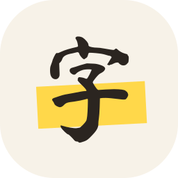

# 汉字之路 hanzi path

Learn Chinese characters the way they're built: every part before the first
common character that uses it. 想 comes after 木, 目, 相 and 心, so when you
meet it you already know what it's made of.

An Android app (Android 12 or later), 2298 items along one path: the 2000
commonest characters and the parts they're made of, with the HSK words and
real sentences you can read as you go. No account, no ads, no internet
permission: your progress stays on the phone.

<p>
  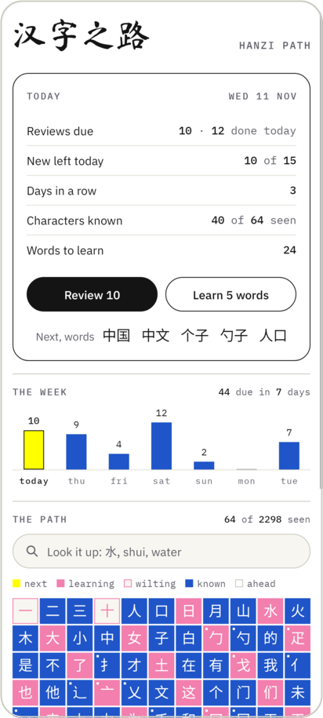
  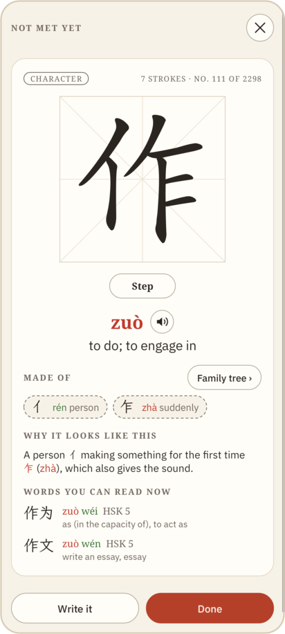
  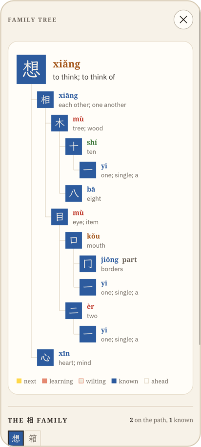
  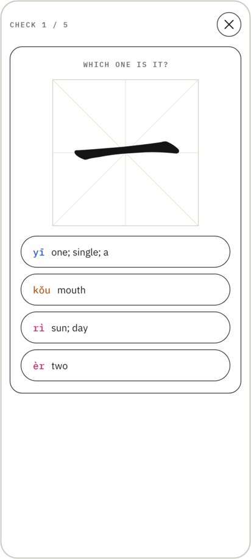
</p>
<p>
  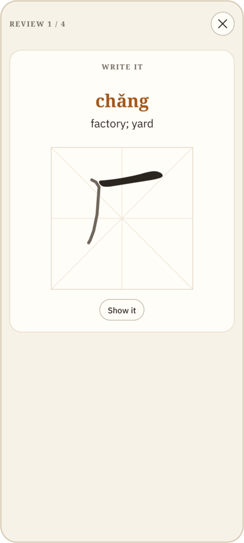
  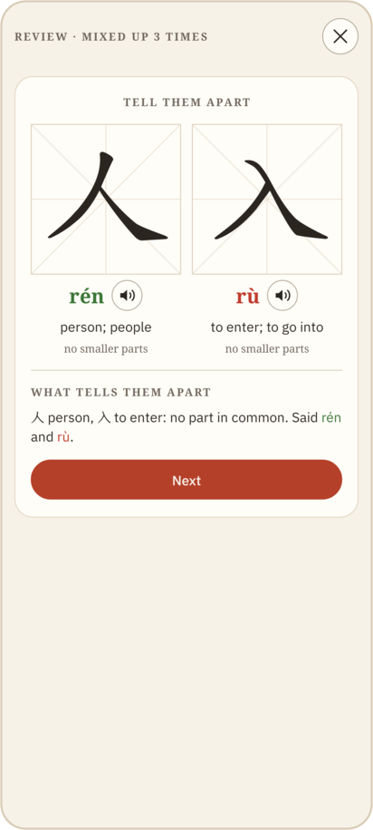
  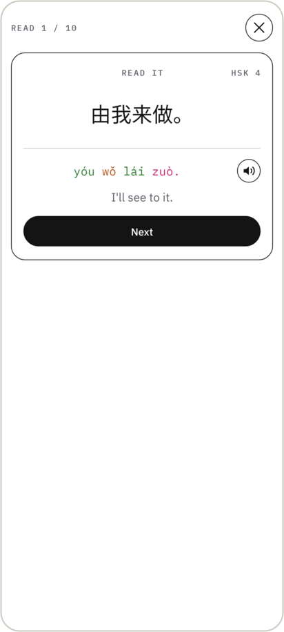
  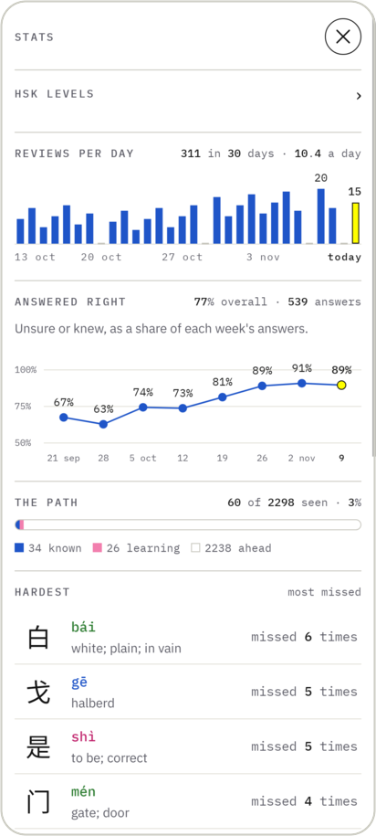
</p>
<p>
  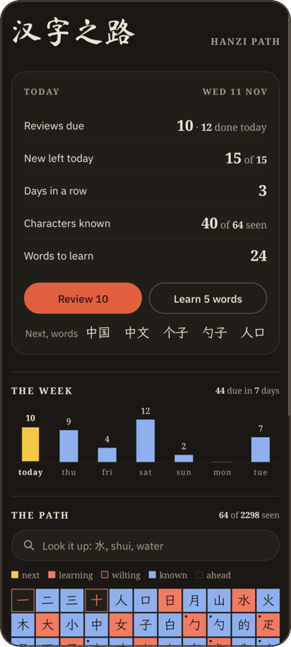
  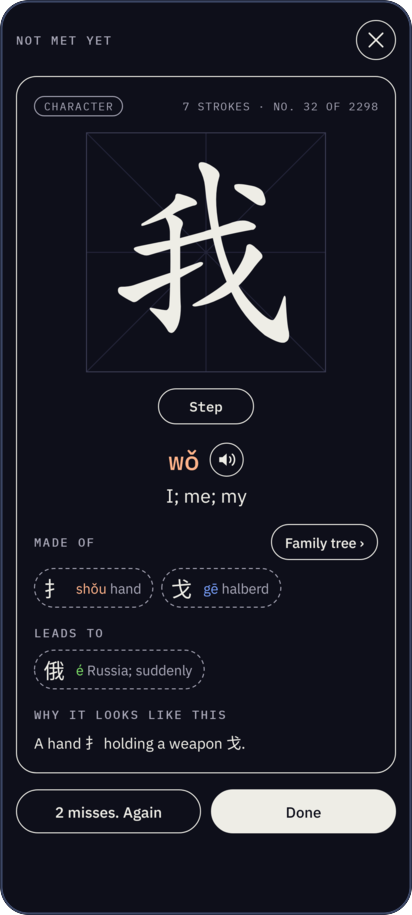
  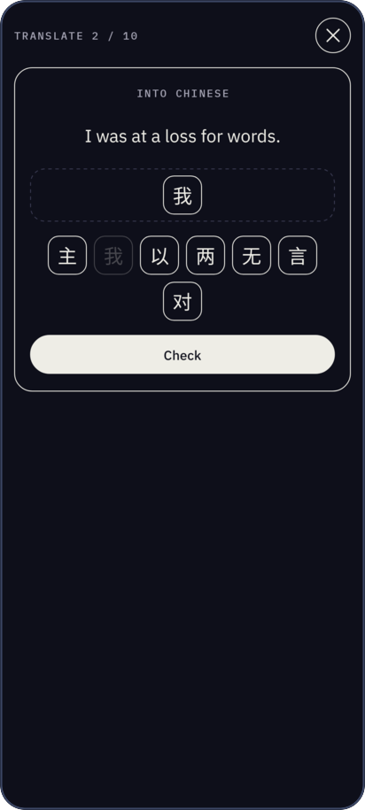
  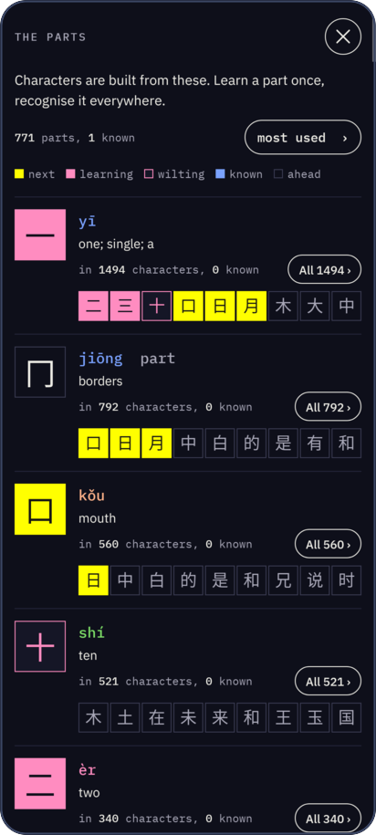
</p>

## Install it

1. On the phone, download
   [hanzi-path.apk](https://github.com/stfrigerio/hanzi-path-app/raw/main/hanzi-path.apk).
2. Open it. Android asks to allow installing apps from your browser (or files
   app) the first time: allow it, then *Install*.

A new version: download it again and install it over the old one. Your
progress stays (Settings → *Copy progress* keeps a copy as text, to move it to
another phone).

## How it works

- **Learn** a batch (5 by default): the strokes animate on a 米字格 (tap the
  square to see them again), it's said aloud (Android's Chinese voice), the
  reading in the tones' inks (1 blue, 2 green, 3 ochre, 4 red), what it's made
  of and what it leads to, why it looks like this (Make Me a Hanzi's etymology:
  which part gives the meaning, which the sound), and the words you can now
  read (HSK's, or CC-CEDICT's where HSK has none). *Step* shows the strokes one
  at a time; *Write it*: trace it with a finger over its outline, stroke by
  stroke.
- **Check**: right after the batch, a round of questions. That's the first
  grade, so a new item starts on what you showed you know.
- **Review**: FSRS-4.5 with three grades (again, unsure, knew). Once the log
  holds 400 grades, a round's end fits the weights to your own answers (on the
  phone, at most weekly), and uses them only if they predict a held-out fifth of
  the cards better. A round takes the most overdue first, 40 at most, in a
  random order.
- **Questions**: the character and four answers, each a reading and a meaning;
  later the other way round (four characters to pick from), by ear (with *Say
  it aloud* on), or written from memory on the empty square. The wrong answers
  are close: characters sharing a part with it, or near it on the path. The tap
  grades it: right in under 8 seconds is knew, right but slower unsure, wrong
  again. *Undo* takes back the last grade.
- **Practice** (nothing due): twenty drawn from the weakest forty, graded as
  reviews are.
- **Mixed up**: two characters taken for each other twice are a pair: their
  wrong answers draw on each other, and now and then a round starts with *Tell
  them apart*, the two side by side.
- **Sentences**: a card shows a real sentence it's in that you can read, every
  character in it met, with its pinyin, the English and a speaker. Once five
  are made only of characters you know, *Read* a round of them, or *Translate*
  them: into English (four to pick from) and into Chinese (its words on tiles,
  tapped in order).
- **Home**: today in four lines (reviews due, new left today, characters known,
  words to learn), the week's reviews, and the path as a garden: marigold next,
  coral learning, blue known, outlined coral wilting. Tap any item to look it up;
  *Search* finds characters, words, readings and meanings.
- A home-screen widget (what's due, a character from the path) and a daily
  reminder.

## The path

`tools/build.py` makes `data/path.json`, `data/strokes-*.json` and
`data/sentences.json` from its sources:

1. A few pictures first, taught whole (一 二 三 十 人 口 日 月 山 水 火 木 大
   小 中 女 子), then the 1000 most common characters (Jun Da's frequency
   list), then on to the 2000 most common.
2. Each one's decomposition (Make Me a Hanzi). Before a character, every part
   of it not yet taught, recursively. A part that is a common character comes
   as a character; one that isn't (氵 亻 扌 讠) comes as a *part*, with what it
   means in a character.
3. Meanings: a short, plain one from CC-CEDICT for the character's main
   reading; for parts, written by hand (`sources/parts.json`).
4. Words: HSK words made only of what's been taught by then, the lowest level
   first, three per character; CC-CEDICT's where no HSK word reaches; and 180
   extra everyday and computer words (`sources/desktop.json`: 终端, 浏览器,
   提交), right after HSK 2.
5. Sentences: Tatoeba's Mandarin sentences with an English translation, 4 to
   20 characters, all on the path, each readable from its last character's
   place.
6. Pinyin as it's said: 不 bú before a 4th tone, 一 yí and yì, 个 ge as a
   measure word, the neutral tone of common words.

Result: 2298 items (1979 characters, 319 parts), 3443 words, 4801 sentences.

## Build it

A JDK and the Android SDK (`$ANDROID_HOME`, default `/opt/android-sdk`): Java
with the platform's own APIs, no Gradle, no dependencies.

```
android/assemble    # the APK, in android/out/
android/install     # the same, put on a phone over adb
android/test/run    # every screen walked in Robolectric and rendered, light and dark (needs mvn)
python3 tools/build.py   # data/ again from its sources (fetched once into ~/.cache/hanzi-path)
tools/cut-han            # the hanzi face (Path Kai) cut again to data/'s characters (needs fontTools)
```

| Path | What |
|---|---|
| `android/src/…/Main.java` | the activity: screens, back, the bars |
| `Home`, `Learn`, `Quiz`, `Settings`, `Cards` | the screens, built in code |
| `Sentences`, `Read` | sentences on the cards, and the Read round |
| `HanziView` | the practice square: strokes, their animation, stepping, writing |
| `GardenView` | the path on the home screen |
| `Progress`, `Fit` | FSRS, its fitted weights, and the database (SQLite) |
| `PathData`, `Glyph` | the path and its stroke shapes (from `data/`) |
| `Ink`, `Ui`, `Flow` | the look: the colours, the faces, pills, cards |
| `Widget` | the home-screen widget |
| `tools/build.py` | the path, from its sources (stdlib Python) |

## Sources and licences

The app and its tools (`android/`, `tools/`) are MIT: `LICENSE`. What comes
from elsewhere keeps its licence, and so does what `tools/build.py` makes of it
in `data/`: `path.json` carries Make Me a Hanzi's dictionary and CC-CEDICT's
meanings, `strokes-*.json` Make Me a Hanzi's strokes, `sentences.json`
Tatoeba's sentences. The texts are in `LICENSES/`.

| What | From | Licence |
|---|---|---|
| decomposition, etymology, pinyin, definitions | [Make Me a Hanzi](https://github.com/skishore/makemeahanzi) `dictionary.txt` | LGPL-3.0 or later (`LICENSES/LGPL-3.0.txt`, which builds on `GPL-3.0.txt`) |
| stroke shapes and order (`data/strokes-*.json`) | Make Me a Hanzi `graphics.txt` | Arphic Public License (`LICENSES/Arphic-1999.txt`) |
| faces (`android/fonts/`) | IBM Plex Sans; Ma Shan Zheng (cut to 汉字之路好行练); LXGW WenKai, cut by `tools/cut-han` and renamed Path Kai | OFL 1.1 (`LICENSES/OFL-1.1.txt`) |
| frequency order | Jun Da, Modern Chinese character frequency list | research use |
| meanings of characters, words beyond HSK | [CC-CEDICT](https://cc-cedict.org/) via [MDBG](https://www.mdbg.net/chinese/dictionary?page=cc-cedict) | CC BY-SA 4.0 (`LICENSES/CC-BY-SA-4.0.txt`) |
| HSK words (`sources/hsk.json`) | [hskhsk.com](https://github.com/glxxyz/hskhsk.com) | MIT (`sources/hsk-LICENSE.txt`) |
| part meanings (`sources/parts.json`), the extra words (`sources/desktop.json`) | by hand | MIT (`LICENSE`) |
| sentences and their English (`data/sentences.json`) | [Tatoeba](https://tatoeba.org) | [CC BY 2.0 FR](https://creativecommons.org/licenses/by/2.0/fr/) |

Made by [Stefano Frigerio](https://github.com/stfrigerio).
